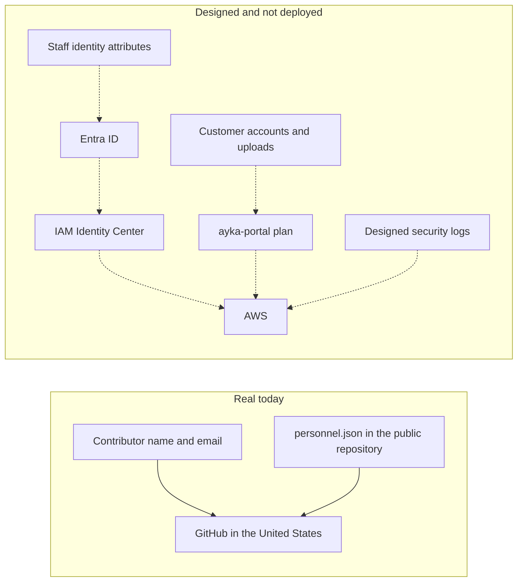

# Data-flow map and international transfer assessment

| Field | Value |
|---|---|
| Document ID | GDPR-06 |
| Owner | Compliance & Risk Management |
| Approver | Managing Director |
| Version | 1.2 |
| Effective | On approval |
| Next review | 12 months after approval, or when a processor, Region or personal-data flow changes |
| Status | Draft. Not approved. Chapter V position selected as a design decision. Certification and contract terms are to verify. Not legal advice |

Ayka Secure Technologies GmbH is a simulated company. This record draws the flows that the repository can support, states which of them are real, and selects the Chapter V position for each supplier (section 3).

## 1. How to read the map

Solid lines are processing that happens now. Dashed lines are design. The target Region for personal data that Ayka intends to host is `eu-central-1` ([ADR-0003](../ADR/0003-target-region.md)). What the Terraform source names is stated once, in the [Region section of the GDPR index](README.md#region). No Terraform root names `ap-south-1` since 2026-11-10; only the console-made Identity Center instance does (RISK-011).

Sources: [processing record](record-of-processing-activities.md), [processor register](processor-register.md), [architecture diagrams](../ISMS/07-technical-evidence/architecture-diagrams.md), [`dev.tfvars`](../../Internal-IT/workloads/ayka-portal/envs/dev.tfvars).

## 2. Flows

| ID | Data | From | To | Reality | Country | What this file decides |
|---|---|---|---|---|---|---|
| DF-01 | Git author name and email, GitHub username, pull-request text, Actions logs | Contributors | GitHub (SUP-03) | Real | United States | A transfer exists. Position selected in section 3 |
| DF-02 | Names, roles and one real owner in `personnel.json` | The repository | GitHub, and anyone who can clone the public repository | Real | United States, and further disclosure by publication | Broader than a processor transfer. PA-01 already records it |
| DF-03 | Staff identity for account provisioning | A future HR record | Microsoft Entra ID (SUP-02), then AWS | Planned | Intended EU Data Boundary; not in operation | Assess planned locations, support access and safeguards before the first real staff data is provisioned |
| DF-04 | Customer account data and uploaded evidence | A future customer | `ayka-portal` on AWS (SUP-01) | Not applied | Target `eu-central-1`. Nothing deployed | Do not describe this as an EU flow while nothing is applied |
| DF-05 | IP addresses and user identifiers in security logs | Future users | AWS logging services | Designed, not delivered | Same position as DF-04 | No log has been delivered, so no log transfer has occurred |

Support access from a provider's staff outside the EU is possible for SUP-01 and SUP-02 and is marked "to verify" in the processor register. It is not mapped as a separate flow because no support session is evidenced.

## 3. Transfer assessment

### 3.1 Method

Chapter V (Art. 44 to 49) applies to a transfer to a controller or processor in a third country. Remote access from a third country to data stored in the EEA counts as a transfer (EDPB Guidelines 05/2021 on the interplay of Art. 3 and Chapter V, **to verify**). Order of reasoning for each importer:

1. Is there a transfer at all? Storage in `eu-central-1` with no access from outside the EEA is not one. Support or administrative access from outside the EEA is.
2. Adequacy (Art. 45). For the United States, Commission Implementing Decision (EU) 2023/1795 of 10 July 2023 (EU–US Data Privacy Framework) covers only importers that are certified. Whether each importer is certified, for which data (HR data is a separate category in the framework) and whether the certification is current is **to verify** on the Data Privacy Framework list. It was not fetched.
3. Appropriate safeguards (Art. 46(2)(c)): standard contractual clauses under Implementing Decision (EU) 2021/914, as a fallback if the importer is not certified, or if the adequacy decision is annulled. Module choice follows the roles: Ayka as controller to a processor (module 2); Ayka as processor to a sub-processor (module 3). Whether the provider's standard terms incorporate them for the plan in use is **to verify**.
4. Derogations (Art. 49) are not used for repeated transfers. No flow here relies on consent or on necessity for a contract.

### 3.2 Position per supplier

| Supplier | Flows | Primary position | Fallback | Status |
|---|---|---|---|---|
| AWS (SUP-01), Amazon Web Services, Inc. as the possible US-side importer | DF-04, DF-05, DF-03 (downstream) | No transfer for stored data in `eu-central-1`. For remote support or administrative access from outside the EEA: Art. 45 DPF if the importer is certified | Art. 46(2)(c) SCCs, module 2 (staff data) or 3 (customer data), as incorporated in the AWS DPA | **To verify**: DPF certification, SCC incorporation, AWS support-access terms. Nothing deployed |
| Microsoft (SUP-02), Microsoft Corp. | DF-03 | Data held in the EU Data Boundary where the tenant is in the EU. Remote access or non-EU processing outside the boundary: Art. 45 DPF if certified | Art. 46(2)(c) SCCs in the Microsoft Products and Services DPA | **To verify**: DPF certification, which Entra ID data stays in the boundary, support access. Lab tenant holds no real staff data |
| GitHub (SUP-03), GitHub, Inc. | DF-01, DF-02 | Art. 45 DPF if GitHub, Inc. is certified. This flow is real now | Art. 46(2)(c) SCCs: module 1 (controller to controller) is the likely fit for a personal account that is governed by the GitHub Privacy Statement; module 2 or 3 if an organization plan with the GitHub DPA is later used | **To verify**: certification, which GitHub terms govern the repository owner's account, whether SCCs are incorporated for that account type |

What the providers' public pages offer, as read in [REAL-SUP-001](../records/real/supplier/REAL-SUP-001-supplier-attestations.md) (second-hand extracts, 2026-11-10): AWS says its DPA applies the SCCs automatically and does not mention the DPF; Microsoft offers SCCs through its data protection terms and its page does not mention the DPF; GitHub's Data Protection Agreement includes the SCCs and lists DPF participation as an alternative basis subject to self-certification. The DPF participant list was opened and showed no data, so no listing was retrieved (open item REAL-SUP-001-O3). Consequence: until O3 is done, the only route with a documented offer for all three is the SCCs. Ayka does not rely on Art. 45 for any of them yet. The primary position stays "DPF where certified" and flips from conditional to relied-on supplier by supplier as the list is checked.

No supplier is assessed on an assumption that an adequacy decision remains valid. The position is written so it survives either outcome: the fallback is named now, not after a ruling.

### 3.3 DF-02: publication of `personnel.json`

A public repository on a US host raises two questions. Whether it is a transfer to GitHub is covered by 3.2. Whether publication is a "transfer" to every reader worldwide is a different question. The CJEU held in *Lindqvist* (C-101/01) that loading personal data onto an internet page hosted in the EU is not by itself a transfer to a third country merely because it is reachable from there. That reasoning was given for a host in the EU. It is not applied here because the host is in the US and the interpretation after the GDPR is **to verify**. The mechanism question is therefore not closed by *Lindqvist*. The disclosure itself has no Chapter V solution: it has to be justified or stopped. PA-01 already records it as an open gap; this document does not cure it.

### 3.4 Short transfer impact assessment (for the SCC fallback)

Scope: DF-01 (real), and DF-03 to DF-05 if the fallback is ever needed. A full assessment per importer remains for the day a contract exists.

| Question | Answer |
|---|---|
| Laws of the third country that could reach the data | US: FISA section 702 and Executive Order 12333 access. The DPF adequacy decision found the safeguards of Executive Order 14086 and the redress mechanism adequate. Those safeguards apply to transfers to the US whatever the mechanism (EDPB information note on the DPF, **to verify**). A court challenge to the decision was brought at the EU General Court; its state is **to verify** |
| Data involved | DF-01: author names, e-mail addresses, usernames, comments. DF-03: staff identity attributes. DF-04 and DF-05: customer user names, e-mail, IP addresses, uploaded evidence (content unknown to Ayka). No special categories are intended (Art. 9) |
| Likelihood of access request | Low for the categories in DF-01 and DF-03. Not assessable for customer evidence until a customer exists |
| Supplementary measures | Data kept in `eu-central-1`; customer-managed KMS keys under the [cryptography policy](../policies/cryptography-policy.md) for the designed stores; minimisation of fields in logs ([STD-MSK-01](../policies/data-masking-standard.md)); no secrets or personal data in tickets or prompts |
| Residual risk and conclusion | DF-01: accepted as a working position for a low-sensitivity, already-public data set; not approved by anyone. DF-03 to DF-05: **no conclusion** until the provider terms are read and a deployment exists |
| Review trigger | Change of provider terms, a new sub-processor, a court ruling on the DPF, or a Region change |

### 3.5 India (`ap-south-1`)

There is no adequacy decision for India that this document relies on (**to verify**). A resource in `ap-south-1` that held personal data, such as the console-made Identity Center instance, would be a transfer to a third country needing Art. 46 safeguards and a transfer assessment, and none is prepared. It is not authorised. The approved direction is the target `eu-central-1`. This document creates no exception.

## 4. Status

Designed. The map is written and a Chapter V position is selected per supplier. It is conditional on facts not yet checked (certification, contract terms) and on a deployment that does not exist. G09 and RISK-011 stay open. The [threat scenario](../ISMS/03-risk-management/threat-scenarios-catalog.md) THR-011 stays valid as long as a source and a target can differ. The [customer DPA template](data-processing-agreement-template.md) carries the same position into Annex III.

## Revision history

| Version | Date | Change |
|---|---|---|
| 1.0 | 2026-10-14 | First issue |
| 1.1 | 2026-11-10 | Chapter V position selected per supplier; transfer impact assessment added; Region fact moved to the GDPR index |
| 1.2 | 2026-11-10 | Region wording follows the moved source: no root names `ap-south-1`, only the Identity Center instance |
