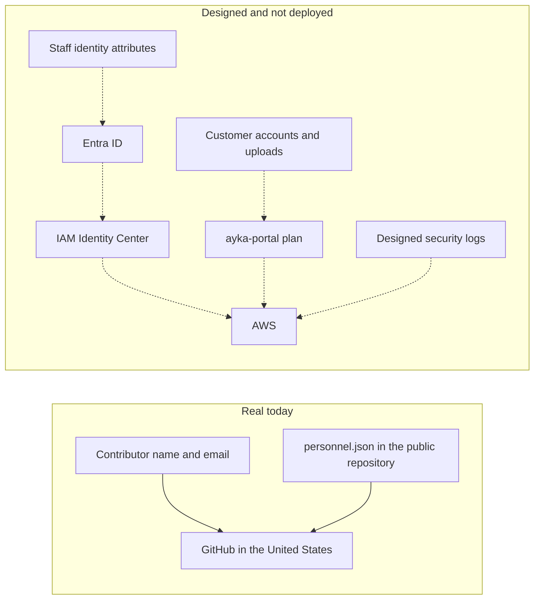

# Data-flow map and international transfer assessment

| Field | Value |
|---|---|
| Document ID | GDPR-06 |
| Owner | Compliance & Risk Management |
| Approver | Managing Director |
| Version | 1.0 |
| Effective | On approval |
| Next review | 12 months after approval, or when a processor, Region or personal-data flow changes |
| Status | Draft. Not approved. Not a transfer-impact conclusion and not legal advice |

Ayka Secure Technologies GmbH is a simulated company. This record draws the flows that the repository can support and states which of them are real. It does not select a Chapter V mechanism.

## 1. How to read the map

Solid lines are processing that happens now. Dashed lines are design. The target Region for personal data that Ayka intends to host is `eu-central-1`. Terraform still names `ap-south-1` (RISK-011). Applying that source would not match the target.

Sources: [processing record](record-of-processing-activities.md), [processor register](processor-register.md), [architecture diagrams](../ISMS/07-technical-evidence/architecture-diagrams.md), [`dev.tfvars`](../../Internal-IT/workloads/ayka-portal/envs/dev.tfvars).

## 2. Flows

| ID | Data | From | To | Reality | Country | What this file decides |
|---|---|---|---|---|---|---|
| DF-01 | Git author name and email, GitHub username, pull-request text, Actions logs | Contributors | GitHub (SUP-03) | Real | United States | A transfer exists. The mechanism is not chosen here |
| DF-02 | Names, roles and one real owner in `personnel.json` | The repository | GitHub, and anyone who can clone the public repository | Real | United States, and further disclosure by publication | Broader than a processor transfer. PA-01 already records it |
| DF-03 | Staff identity for account provisioning | A future HR record | Microsoft Entra ID (SUP-02), then AWS | Planned | Intended EU Data Boundary; not in operation | Assess planned locations, support access and safeguards before the first real staff data is provisioned |
| DF-04 | Customer account data and uploaded evidence | A future customer | `ayka-portal` on AWS (SUP-01) | Not applied | Target `eu-central-1`. Current source `ap-south-1` | Do not describe this as an EU flow |
| DF-05 | IP addresses and user identifiers in security logs | Future users | AWS logging services | Designed, not delivered | Same Region conflict as DF-04 | No log has been delivered, so no log transfer has occurred |

Support access from a provider's staff outside the EU is possible for SUP-01 and SUP-02 and is marked "to verify" in the processor register. It is not mapped as a separate flow because no support session is evidenced.

## 3. Transfer assessment

Chapter V of the GDPR covers every transfer of personal data outside the EEA, including adequacy decisions (Art. 45), appropriate safeguards (Art. 46) and derogations for specific situations (Art. 49). The text and current adequacy list are **to verify**; this section does not rely on an adequacy decision for the United States or for India.

| Flow | Why it is in this section | Mechanism recorded in the processor register | Conclusion |
|---|---|---|---|
| DF-01, DF-02 | GitHub hosting is in the United States, and DF-02 is public | SUP-03 names the EU–US Data Privacy Framework and standard contractual clauses, both **to verify**. The GitHub DPA's scope for a personal account is also **to verify** | Not concluded. No transfer impact assessment is signed. Publication of DF-02 is a separate disclosure decision, still open in the processing record |
| DF-04, DF-05 if the current Terraform were applied | `ap-south-1` is Mumbai. That would place designed personal data in India | No mechanism is named for India | Not authorised. The approved direction is to change the source to `eu-central-1` or to record a justified exception before any apply. This document does not create that exception |
| DF-03 | Not in operation | SUP-02 names DPF and SCCs, **to verify** | Assess planned locations, support access and safeguards before the first real staff data is provisioned |

A Data Privacy Framework listing or a signed SCC would still need a check of the actual service, the actual account plan and any onward support access. None of those documents is in this repository.

## 4. Status

Designed as a map and as an unfinished assessment. G09 and RISK-011 stay open. The [threat scenario](../ISMS/03-risk-management/threat-scenarios-catalog.md) THR-011 remains valid: the conflict between target and source is still there. The missing artefact is no longer "no data-flow record". It is a concluded mechanism and a source that matches the target.

## Revision history

| Version | Date | Change |
|---|---|---|
| 1.0 | 2026-10-14 | First issue |
