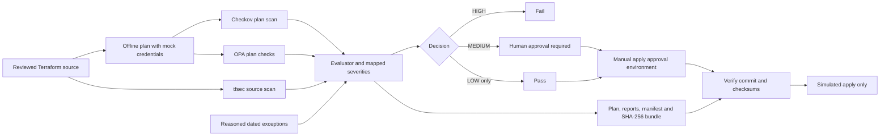
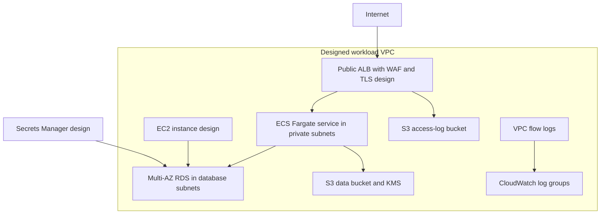
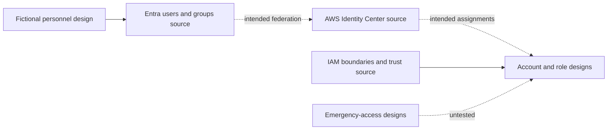

# Architecture diagrams

| Field | Value |
|---|---|
| Document ID | ISMS-07-03 |
| Owner | Cloud Platform Engineering |
| Approver | Managing Director |
| Version | 1.0 |
| Effective | On approval |
| Next review | 12 months after approval, or when scope, source configuration or evidence changes |
| Status | Draft. Not approved: no approval record exists (simulated company) |

> Ayka Secure Technologies GmbH is a simulated company. The CI gate operates on plans; the infrastructure has never been deployed.

## 1. Implemented evidence flow

Sources: [workflow](../../../.github/workflows/terraform-workflow.yml), [evaluator](../../../Internal-IT/engineering/ci-cd/scripts/evaluate-results.py), [apply wrapper](../../../Internal-IT/engineering/ci-cd/scripts/run-apply.sh), [evidence index](control-evidence-index.md). The gate and evidence packaging operate. Checksum verification detects mismatches; it does not establish independent authenticity. The apply wrapper creates no resources.

## 2. Gated workload design

Sources: [workload modules](../../../Internal-IT/workloads/ayka-portal/modules/) and [generated resource inventory](../02-asset-management/asset-inventory.md). Arrows describe intended configuration or data paths, not observed traffic. The sample container, AMI and self-signed certificate are placeholders; no service exists. Target Region is eu-central-1; source inconsistency remains [RISK-011](../03-risk-management/risk-register.md).

## 3. Ungated identity design

Sources: [identity architecture](../../architecture/identity-architecture.md), [platform identity roots](../../../Internal-IT/platform/domains/identity/) and [privileged access justification](../04-controls-and-soa/privileged-access-justification.md). All components in this diagram are **Designed**, outside the gated workload. Dashed arrows are unverified integration assumptions, including SCIM/federation and emergency access. Consult the architecture for source conflicts before treating any relationship as usable.

## 4. Diagram maintenance

Cloud Platform Engineering updates diagrams when a source boundary or data path changes. The reviewer checks each box against a source path and ensures that an intended arrow has not become an operating claim. Detailed identity boundaries remain in the linked architecture; these views are navigation aids.

## Revision history

| Version | Date | Change |
|---|---|---|
| 1.0 | 2026-10-14 | First issue |
