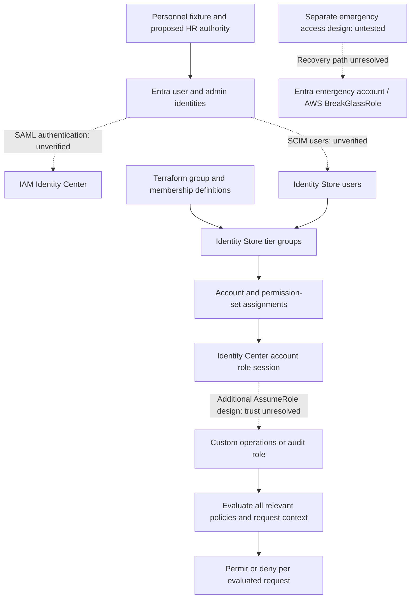

# Identity architecture

| Field | Value |
|---|---|
| Document ID | ARCH-IAM-01 |
| Owner | Cloud Platform Engineering |
| Approver | Managing Director |
| Version | 1.0 |
| Effective | On approval |
| Next review | 12 months after approval, or identity source, trust, account or access-model change |
| Status | Draft. Not approved: no approval record exists (simulated company) |

Ayka Secure Technologies GmbH is a simulated company. **Status of the architecture: Designed.** Platform identity Terraform is outside the workload compliance gate and never deployed as this platform. The diagram is intended flow, not proof of federation, provisioning, authorization or monitoring.

## 1. Intended identity flow

Authentication and provisioning are separate paths. IAM Identity Center permission sets define account access; the additional custom-role hop is a separate repository design choice that needs trust validation. The previous direct `sts:AssumeRoleWithSAML` arrow to all custom roles did not describe the source accurately. See [AWS permission-set documentation](https://docs.aws.amazon.com/singlesignon/latest/userguide/permissionsetsconcept.html) for the provider mechanism; this is not evidence that it is configured here.

## 2. Components and source facts

| Component | Source evidence | Current fact and limit |
|---|---|---|
| Personnel and Entra identities | [fixture](../../Internal-IT/platform/domains/identity/entra-id/modules/core/personnel.json); [normalization](../../Internal-IT/platform/domains/identity/entra-id/modules/core/locals_personnel.tf); [users](../../Internal-IT/platform/domains/identity/entra-id/modules/core/users.tf) | Fictional personnel drive account and group definitions. This is not a real HR authority or record of account provisioning. |
| Privileged and emergency Entra identities | [admin accounts](../../Internal-IT/platform/domains/identity/entra-id/modules/privileged/admin_accounts.tf); [emergency lookup](../../Internal-IT/platform/domains/identity/entra-id/modules/privileged/break_glass.tf) | Separate admin-user resources and a lookup of a manually managed emergency account exist. Directory role assignments, actual credential custody and tested recovery are not evidenced. |
| Conditional Access | [feature switch](../../Internal-IT/platform/domains/identity/entra-id/variables.tf); [module wiring](../../Internal-IT/platform/domains/identity/entra-id/main.tf) | enable_conditional_access defaults false. MFA and legacy-authentication policy source exists, but its presence does not establish active MFA. Licence eligibility and actual tenant settings remain to verify. |
| Identity Store groups and memberships | [groups](../../Internal-IT/platform/domains/identity/aws-identity-center/groups.tf); [memberships](../../Internal-IT/platform/domains/identity/aws-identity-center/memberships.tf) | Terraform defines groups and static memberships, and looks up users by username. This differs from legacy full group-sync and manual-group narratives; no SCIM result is proven. |
| Permission sets and account assignment | [permission sets](../../Internal-IT/platform/domains/identity/aws-identity-center/permission-sets.tf); [assignments](../../Internal-IT/platform/domains/identity/aws-identity-center/assignments.tf) | Tier0 Platform-Admin, Tier1-Ops and Tier2-Workload each specify PT8H. All three account assignments use management_account_id; intended multi-account separation is unproven. |
| Session and attribute definitions | [session controls](../../Internal-IT/platform/domains/identity/aws-identity-center/session-controls.tf) | Restricted-Admin specifies PT1H but is unassigned. Mapped attributes are AccessTier and CostCenter; Department and Environment required by other policies are absent from this mapping. |
| Custom roles, trust and policies | [roles](../../Internal-IT/platform/domains/identity/aws-iam-core/cross-account-roles.tf); [trust](../../Internal-IT/platform/domains/identity/aws-iam-core/trust-policies.tf); [policies](../../Internal-IT/platform/domains/identity/aws-iam-core/custom-policies.tf) | Operations roles reference a trust with the service principal sso.amazonaws.com, not a demonstrated source role session. Audit trust uses security-account root; all custom roles specify one-hour maxima. |
| Emergency AWS access | [BreakGlassRole](../../Internal-IT/platform/domains/identity/aws-iam-core/break-glass-role.tf); [trust](../../Internal-IT/platform/domains/identity/aws-iam-core/trust-policies.tf) | AdministratorAccess attachment and management-account-root trust with an MFA context condition exist. Reachability during identity failure and notification are untested. |

## 3. Design contradictions that block reliance

| Issue | Source evidence | Required resolution |
|---|---|---|
| Identity authority and lifecycle | [legacy boundary decision](../../Internal-IT/platform/domains/identity/docs/identity-boundary-decision.md); [SCIM notes](../../Internal-IT/platform/domains/identity/docs/scim.md); [membership source](../../Internal-IT/platform/domains/identity/aws-identity-center/memberships.tf) | Reconcile user-only versus group-sync claims and Terraform versus manual group ownership. Approve authoritative usernames and test joiner, mover and leaver behavior. Legacy statements of operational federation are unsupported here. |
| Permission boundary contains only Deny statements | [boundary](../../Internal-IT/platform/domains/identity/aws-iam-core/permissions-boundaries.tf); [role attachments](../../Internal-IT/platform/domains/identity/aws-iam-core/cross-account-roles.tf) | Define the intended allowed ceiling and test complete policy composition. A boundary with no Allow cannot support the intended identity-policy permissions; account for resource policies and other policy types separately. |
| ABAC does not establish isolation | [ABAC policies](../../Internal-IT/platform/domains/identity/aws-iam-core/abac-custom-policies.tf); [role policies](../../Internal-IT/platform/domains/identity/aws-iam-core/custom-policies.tf); [attributes](../../Internal-IT/platform/domains/identity/aws-identity-center/session-controls.tf) | Supply and protect required attributes; assess additional broad Allows and actual attachments. Conditional Allow statements alone do not prove all other paths are denied. |
| Trust path and scope are unresolved | [trust](../../Internal-IT/platform/domains/identity/aws-iam-core/trust-policies.tf); [permission sets](../../Internal-IT/platform/domains/identity/aws-identity-center/permission-sets.tf) | Verify the exact permitted source principals, target accounts and STS request context. Wildcard account targets and broad root trust are not an approved trust boundary. |
| Audit role exceeds its stated purpose | [security audit policy](../../Internal-IT/platform/domains/identity/aws-iam-core/custom-policies.tf) | Review guardduty:*, config:* and securityhub:*; replace broad access with actions justified by the actual audit task. Do not call this role read-only. |
| Session restrictions are inconsistent | [permission sets](../../Internal-IT/platform/domains/identity/aws-identity-center/permission-sets.tf); [unassigned short session](../../Internal-IT/platform/domains/identity/aws-identity-center/session-controls.tf) | Approve appropriate duration per path; an unassigned one-hour permission set does not restrict the three eight-hour sets. Test any role chaining separately. |
| Emergency dependencies and MFA assumptions | [emergency procedure](../../Internal-IT/platform/domains/identity/docs/break-glass-procedure.md); [trust](../../Internal-IT/platform/domains/identity/aws-iam-core/trust-policies.tf) | Replace unverified hardware-key, safe and automatic-paging claims with tested arrangements. Demonstrate a path available during federation failure. Federated MFA does not automatically supply the IAM MFA context key. |
| Region and state prerequisites | [Identity Center provider](../../Internal-IT/platform/domains/identity/aws-identity-center/provider.tf); [Entra backend](../../Internal-IT/platform/domains/identity/entra-id/provider.tf); [risk register](../ISMS/03-risk-management/risk-register.md) | Reconcile ap-south-1 sources with the eu-central-1 target (RISK-011); establish state custody and approved bootstrap order before any live setup (RISK-002/RISK-012). |

The boundary conclusion follows the [AWS boundary evaluation rules](https://docs.aws.amazon.com/IAM/latest/UserGuide/access_policies_boundaries.html): identity-policy permissions must also be allowed by the boundary, while resource-policy/session grants require separate analysis. This is a source-based inference, not an executed permission test. [AWS's MFA context-key documentation](https://docs.aws.amazon.com/IAM/latest/UserGuide/reference_policies_condition-keys.html#condition-keys-multifactorauthpresent) explains why an MFA condition is not evidence of a particular physical authentication device or a working federated emergency path.

## 4. Validation and ownership

Cloud Platform Engineering must reconcile the design, establish state and bootstrap prerequisites, and produce scoped positive and negative permission tests. CISO reviews role need, emergency access and residual risk; the Managing Director approves access and any accepted residual risk. Verify tenant licences and provider configuration from current primary evidence before relying on them.

Required evidence includes approved role scopes, actual group and account assignments, SAML/SCIM configuration and lifecycle results, authentication challenges, denied access cases, applicable policy composition, emergency recovery and alert delivery. Keep secrets and detailed identity exports in restricted evidence storage. No such validation is recorded by this document.

Use the [IAM mapping](../ISMS/04-controls-and-soa/iam-iso27001-mapping.md), [privileged access justification](../ISMS/04-controls-and-soa/privileged-access-justification.md) and [control gap analysis](../ISMS/04-controls-and-soa/control-gap-analysis.md) for control traceability. The broader [access control policy](../policies/access-control-policy.md) defines required behavior; source code remains a design until evidence establishes operation.

## Revision history

| Version | Date | Change |
|---|---|---|
| 1.0 | 2026-10-14 | Replace operational claims with source-backed design and validation gaps |
